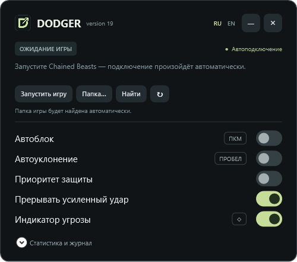
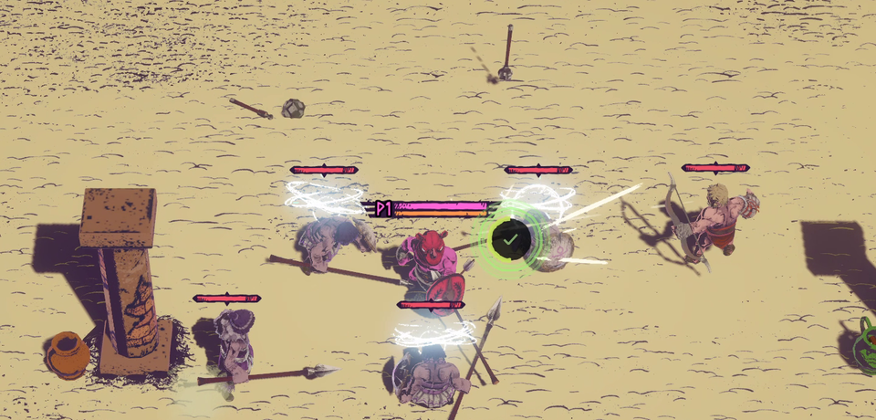

# Screenshots

## Desktop panel

The version 19 WPF panel in English and Russian, exported from the application's own renderer in its disconnected state.

## In-game HUD

A frame from the staged in-game demonstration. The indicator shows threats and shield durability beside the player.

[Animated demonstration](https://github.com/x1pee/Dodger/releases/download/v18/Dodger-demo.gif) · [MP4](https://github.com/x1pee/Dodger/releases/download/v18/Dodger-demo.mp4)
